# LibreTV-fnOS 部署与使用操作指南

> **适用版本**：LibreTV-fnOS 1.0.9（2026-10-20）
> **适用环境**：飞牛 fnOS 1.2.0800 / 飞牛影视 0.9.8-1（其他相近版本可参考）
> **文档说明**：截图来自真实运行环境；截图中的 `192.168.3.83` 为示例 NAS 地址、
> 媒体账号与 MCP Token 已做脱敏处理，请以你自己的实际信息替换。

---

## 目录

1. 产品与架构
2. 前置条件
3. 安装部署（含应用中心、安装向导、授权目录）
4. 首次配置（LibreTV + 飞牛影视）
5. 使用：搜索并加入媒体库
6. 播放方式（局域网 / 公网 / FN Connect 中继）
7. 自动追更与空目录回收（1.0.9）
8. OTA 自动更新（1.0.7+）
9. MCP 接入（大模型管理）
10. 目录结构与配置项
11. 常见问题与故障排查
12. 安全、备份与卸载
13. 附录：版本与链接

---

## 1. 产品与架构

LibreTV-fnOS 把开源 LibreTV 封装为飞牛 OS 原生 FPK，并在同一个 Node 进程内集成 5 个模块：

| 模块 | 端口 | 作用 |
|---|---|---|
| LibreTV Web（Next.js） | 8090 | 搜索采集站资源、详情页「加入媒体库」、设置 |
| STRM 引擎 | 进程内 | 生成/追更 `.strm`、索引、增量同步、空目录回收、飞牛影视扫描 |
| 影视兼容代理 | 8091 | 反向代理飞牛影视 Web，把 HLS 直链改写为 NAS 本地中转（LAN/公网播放） |
| MCP 服务 | 8092（内部 8093 更新服务） | 给 DeepSeek Harness / WorkBuddy 等 AI 客户端管理媒体库 |
| OTA 更新器 | 内部 8093 | 检查 GitHub Releases、下载校验、替换并自动重启 |

**数据流**：

```
搜索/入库：LibreTV(8090) → CMS 采集站 → STRM 引擎 → strmdata/*.strm → 飞牛影视扫描
播放：飞牛影视/兼容入口 → 源站 HLS（LAN/公网可走 8091 中转；中继下客户端直连源站）
管理：AI 客户端 → MCP(8092) → 同一队列/索引/引擎
```

---

## 2. 前置条件

1. 飞牛 fnOS **≥ 1.1.8**（实测 1.2.0800），x86_64；
2. 已安装 **飞牛影视**（trim.media，实测 0.9.8-1）；
3. 有 **管理员账号**（安装 FPK、授权目录需要）；
4. 存储空间：建议应用安装到 `/vol2`，STRM 目录也放在同一存储空间，例如
   `/vol2/1000/liberTV/strmdata`；
5. 网络：
   - 局域网/公网直连：可访问 8090、8091、8092；
   - FN Connect 中继：只转发 fnOS 主网关，**8090/8091/8092 不可达**，中继播放使用飞牛影视原生客户端直连源站；
6. 下载安装包：GitHub Releases 中的 `libretv-1.0.9.fpk`。


---

## 3. 安装部署

### 3.1 登录 fnOS 桌面

浏览器打开 `http://<NAS-IP>:5666`，输入管理员账号密码登录，进入桌面。

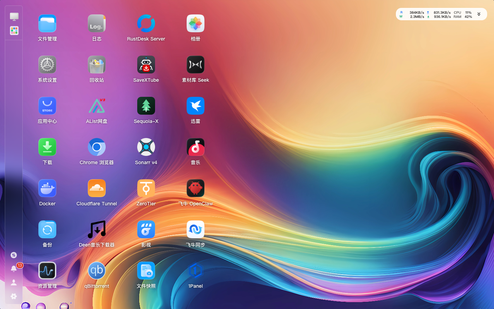

### 3.2 打开应用中心

点击桌面/侧边栏 **应用中心**。

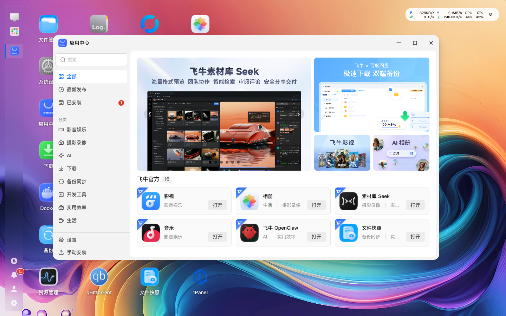

### 3.3 进入「已安装」并手动安装

1. 左侧点击 **已安装**，可查看当前已安装应用；
2. 点击左下角 **手动安装**。

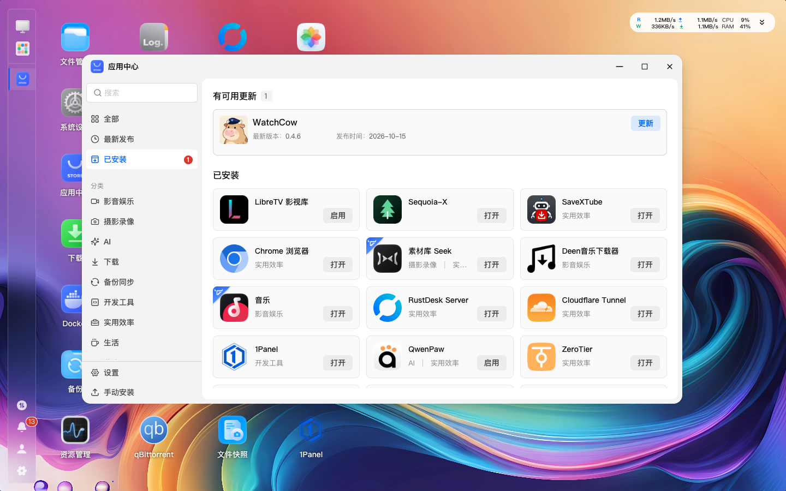

### 3.4 选择存储空间并上传 FPK

1. 在「手动安装」弹窗中选择 **存储空间 2（/vol2）**；
2. 点击 **从电脑上传**，选择下载好的 `libretv-1.0.9.fpk`；
3. 也可先把 FPK 放到 NAS 文件目录，使用 **从 NAS 添加**。

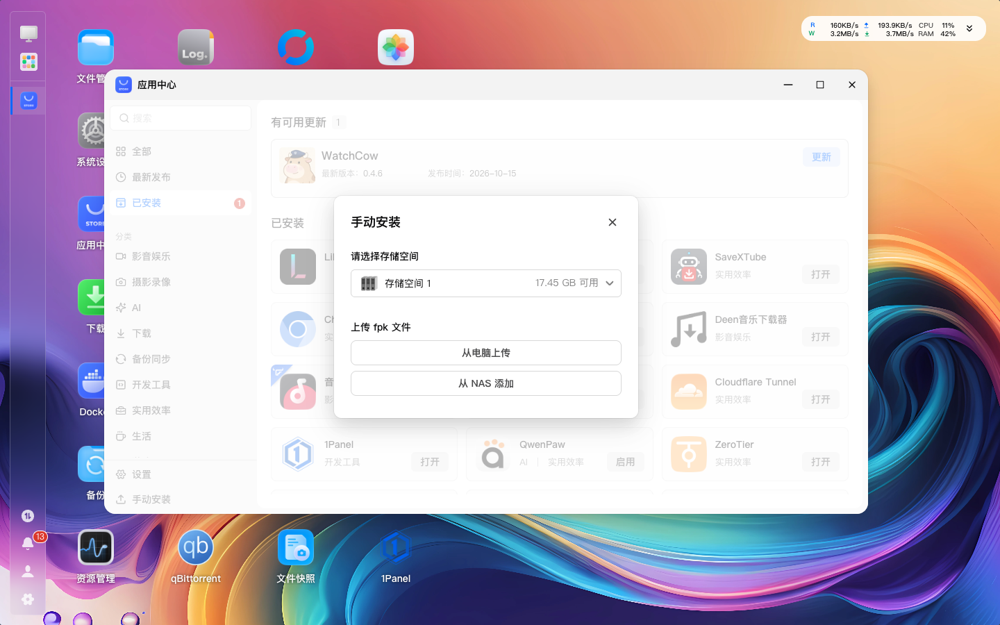

### 3.5 安装向导

上传后进入安装向导，按提示填写：

| 字段 | 建议值 | 说明 |
|---|---|---|
| STRM 根目录 | `/vol2/1000/liberTV/strmdata` | 必须先在「文件管理」中创建普通文件夹，**不要**使用 `@appdata` 应用内部目录 |
| 访问密码 | 自定义 | LibreTV Web 登录密码，不是 fnOS 密码 |

> 向导中填写的值会写入 `var/config.json`；升级/重装保留 `var/` 时不会覆盖已有配置。

### 3.6 启动并确认版本

安装完成后回到 **已安装**，找到 **LibreTV 影视库**：

- 点击 **启用/打开**；
- 点击应用卡片可查看 **当前版本**（应为 1.0.9）、安装位置、来源。

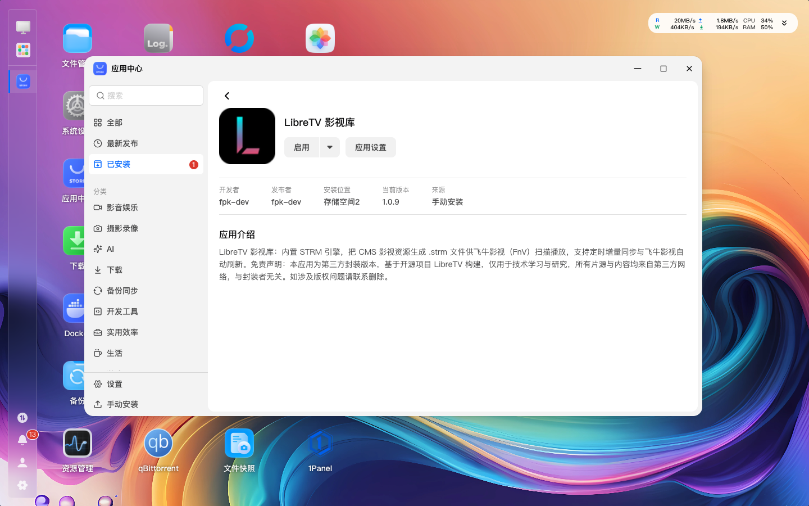

### 3.7 授权 STRM 目录（关键）

应用以独立用户 `libretv` 运行，必须让它能读写 STRM 目录：

1. 应用卡片 → **应用设置**；
2. 切到 **访问权限**；
3. 点击 **添加**，选择 STRM 目录（如 `/vol2/1000/liberTV/strmdata`），权限选择 **读写**；
4. 保存。

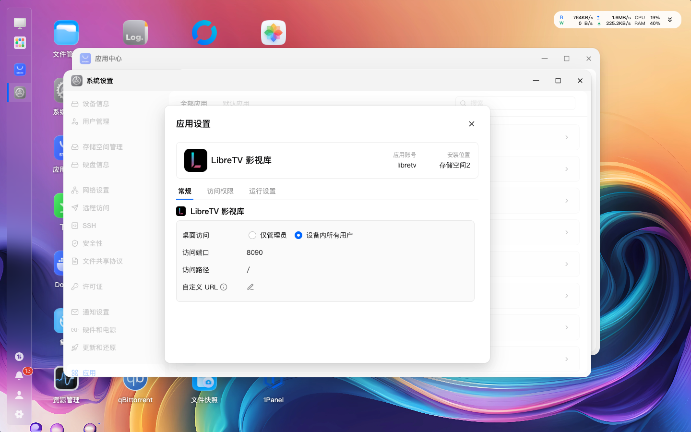

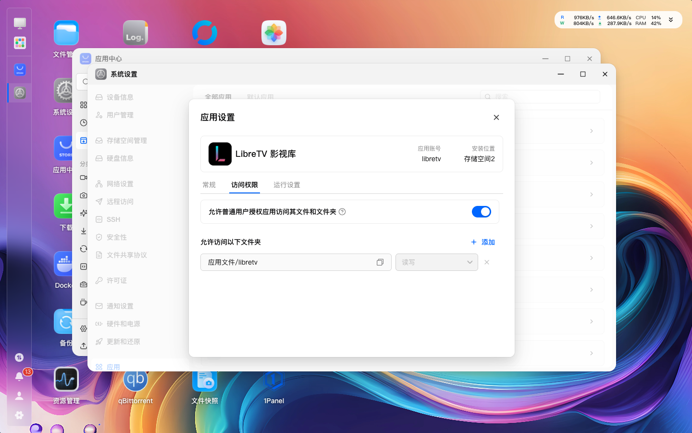

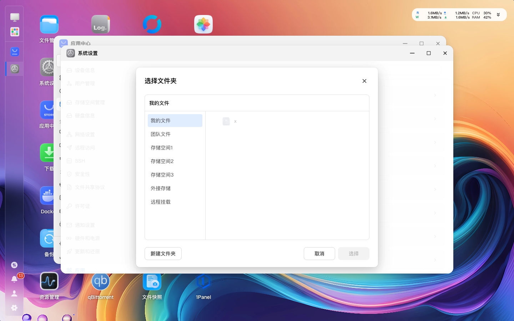

---

## 4. 首次配置

### 4.1 登录 LibreTV

浏览器打开 `http://<NAS-IP>:8090`，页面显示访问验证，输入安装向导中设置的访问密码。

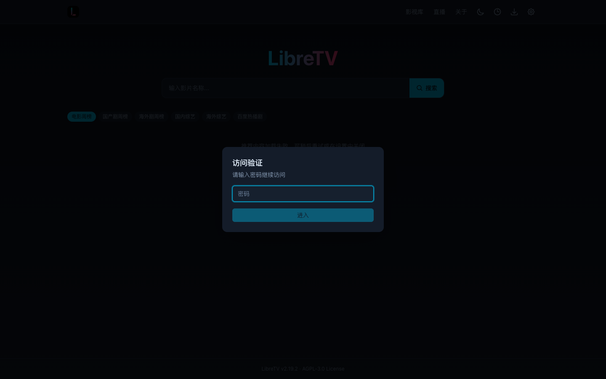

登录后进入首页：

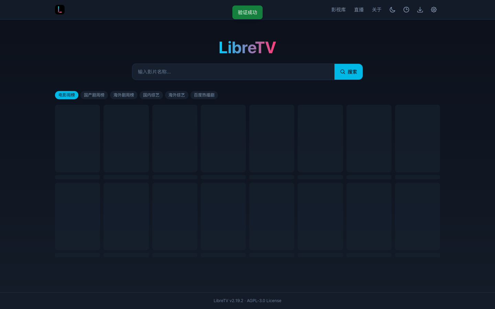

### 4.2 媒体库设置

点击右上角 **设置（齿轮）** → **媒体库**：

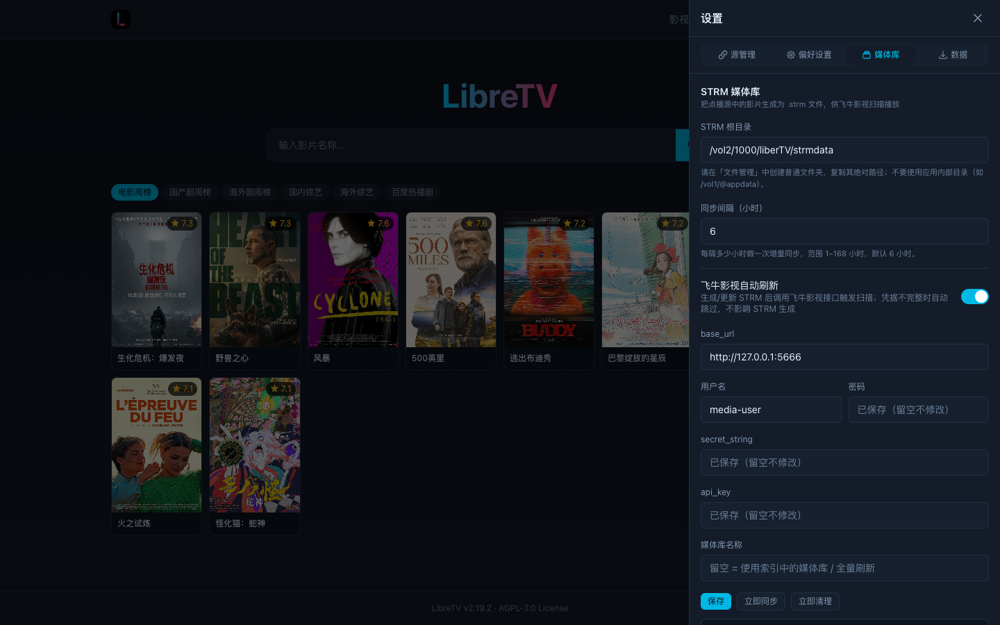

| 配置项 | 建议值 | 说明 |
|---|---|---|
| STRM 根目录 | `/vol2/1000/liberTV/strmdata` | 与授权目录一致 |
| 同步间隔（小时） | 6（默认） | 追更频率；可改为 1–2 小时 |
| 飞牛影视自动刷新 | 开启 | 生成/追更后触发影视扫描 |
| base_url | `http://127.0.0.1:5666` | 本机飞牛影视网关 |
| 用户名 / 密码 | 你的飞牛影视账号 | 用于自动刷新媒体库 |
| secret_string / api_key | 已内置，留空不改 | 影视前端公开常量，无需填写 |
| 媒体库名称 | 留空 | 留空表示自动匹配包含 STRM 目录的媒体库 |

填写后点 **保存**；可点 **立即同步 / 立即清理** 手动触发。运行状态区可查看索引条目、队列、
最近同步、STRM 目录可写性等。

### 4.3 在飞牛影视中添加媒体库

1. 打开飞牛影视（桌面 App 或 `http://<NAS-IP>:5666/v/`）；
2. 首次使用需用飞牛影视账号登录（也可尝试「使用 NAS 登录」）：

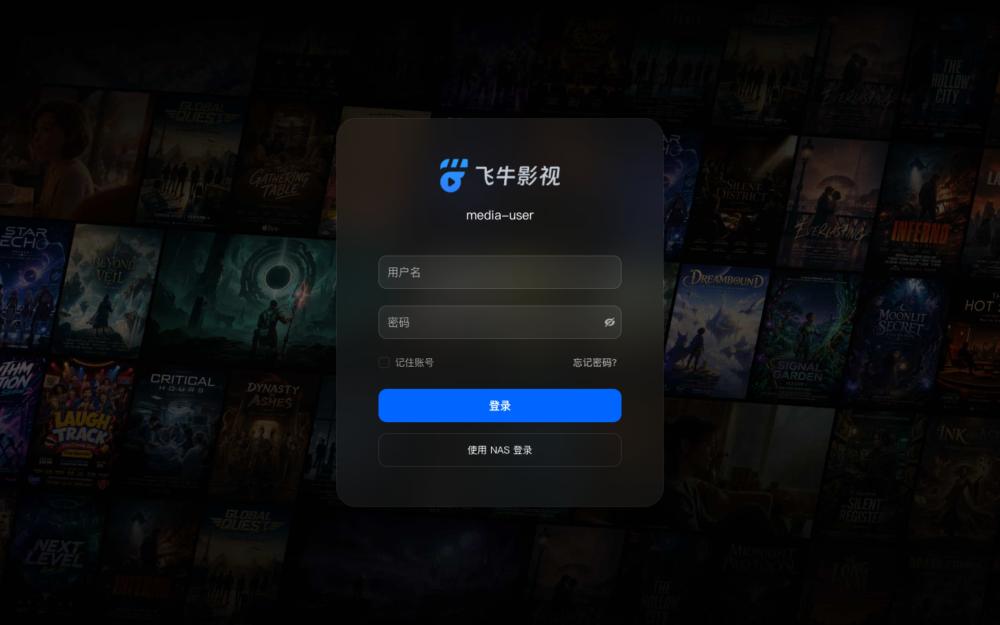

3. 进入 **设置 → 媒体库 → 添加媒体库**；
4. 类型选择 **电影/电视剧**（或“其他/混合”），目录选择
   `/vol2/1000/liberTV/strmdata`；
5. 保存并触发扫描。扫描完成后，STRM 会以海报墙形式出现。

> 若媒体库路径与 STRM 根目录不一致，自动刷新会提示“未找到媒体库”，但飞牛影视的文件监控
> 仍会在文件变化后同步；建议把媒体库直接指向 strmdata。

---

## 5. 使用：搜索并加入媒体库

### 5.1 搜索

首页搜索框输入片名（如「庆余年」），回车：

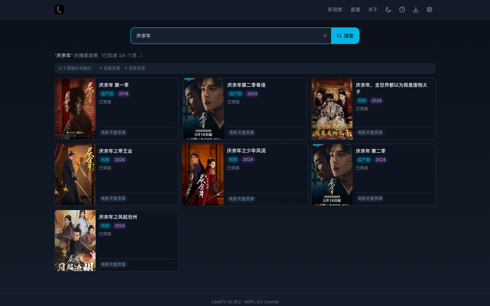

### 5.2 打开详情并加入媒体库

点击目标影片卡片，打开详情弹窗；弹窗右上角有 **「加入媒体库」** 按钮。

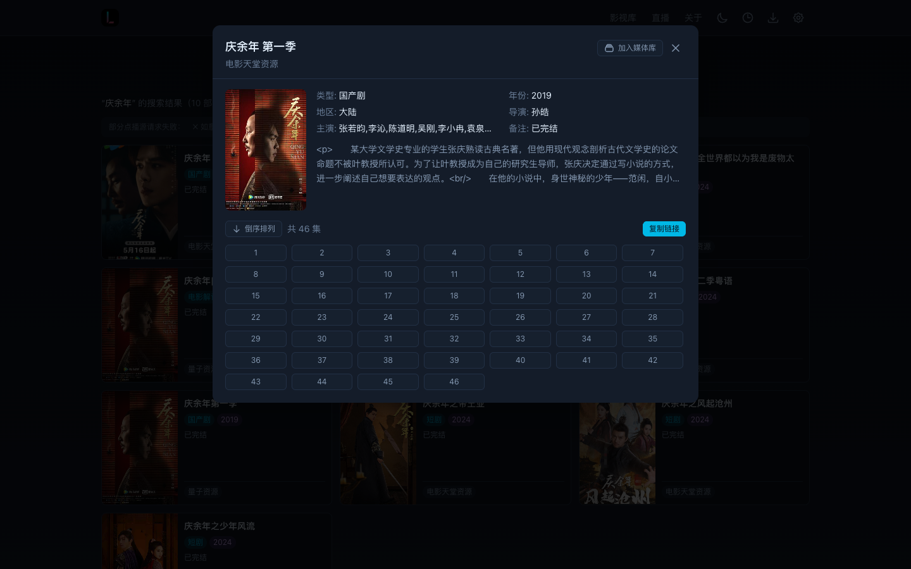

点击后：

1. 页面提示“已加入，稍后出现在影视库中”；
2. 后台生成 `.strm`：
   - 电影：`strmdata/片名 (年份)/片名 (年份).strm`
   - 剧集：`strmdata/剧名 (年份)/Season 01/剧名 - S01E01.strm`
3. 自动更新索引并触发飞牛影视扫描；
4. 在设置 → 媒体库 → 运行状态里可看到索引条目增加。

> 同一部片重复点击不会重复生成；如需换源，先删除旧条目再重新加入。

---

## 6. 播放方式

### 6.1 局域网 / 公网直连（推荐 8091 兼容入口）

- 打开 LibreTV（8090），点击顶部 **影视库**，会打开
  `http://<NAS-IP>:8091/`（飞牛影视 Web 的应用内兼容代理）；
- 首次使用需登录飞牛影视账号；
- 播放时由 NAS 中转 HLS，兼容性最好，不依赖客户端网络直连源站；
- 首次登录页面：


### 6.2 FN Connect / 中继

- 中继只转发 fnOS 主网关（443/5666/5667），8090/8091 不可达；
- 观看者请直接使用 **飞牛影视原生 App/页面**（不要点 LibreTV 的「影视库」）；
- 原生播放由客户端直连源站，**不经过 NAS 与中继**，画质与带宽最优；
- 我已实测《沙丘》《庆余年》在中继下原生播放成功。

### 6.3 播放失败排查

- 报“STRM 直连播放异常”：
  - 中继场景 → 检查客户端网络能否直接访问源站 CDN；
  - 局域网/公网 → 改用 8091 兼容入口；
  - 使用 Clash 等代理 → 把采集站 CDN 加入 DIRECT（见 `docs/CLASH-RULES.md`）。

---

## 7. 自动追更与空目录回收（1.0.9）

### 7.1 自动追更

- 每轮增量同步（默认 6 小时，可在设置改成 1–168 小时）都会重新拉取已入库条目的详情；
- 源站新增剧集（如入库时 9 集、后来更新到 30 集）→ 自动补写新增集的 `.strm` 并触发影视扫描；
- 本地 `.strm` 被误删但源站 URL 未变 → 同步时自动补齐；
- 同步结果记录 `episodesAdded` / `filesRestored`，日志显示“新增文件=N（追更）”。

### 7.2 空资源目录回收

- 每 5 分钟扫描 `strmdata` 第一层资源目录；
- 若资源目录内 **0 个 `.strm`** 且目录 mtime 超过 **5 分钟宽限**：
  1. 递归删除整个资源目录（含 nfo、海报、字幕等）；
  2. 移除索引中相关条目；
  3. 触发飞牛影视扫描，海报墙同步消失；
- 只删部分集数不会触发整目录回收，下次同步会自动补齐；
- 可配置（`var/config.json`）：
  - `"cleanupEmptyDirs": false` 关闭；
  - `"emptyDirGraceMinutes": 10` 调整宽限（1–60）。

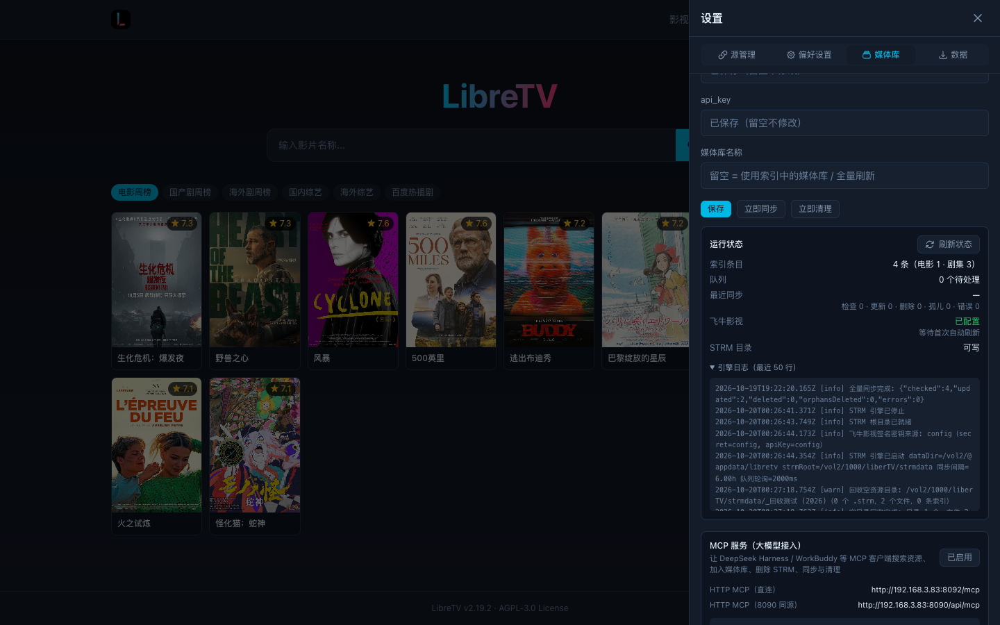

> 建议：想更快追更，把同步间隔设为 1–2 小时；采集源请求量随条目数增加。

---

## 8. OTA 自动更新（1.0.7+）

- 启动 15 秒后 + 每 6 小时检查 GitHub Releases；
- 有新版时顶部导航出现 **「更新 vX」** 按钮（不是设置页里的固定按钮）；
- 点击后：下载 `libretv-update-<ver>.tar.gz` → release digest 校验 → 原子替换运行文件 →
  自动重启（约 3–5 秒）；失败自动回滚；
- 只替换运行载荷，配置 / STRM 索引 / 媒体库数据保留；
- **应用中心版本不会随 OTA 变化**：应用中心显示你安装的 FPK 版本，应用内显示实际运行版本，
  这是正常现象；到应用中心安装新 FPK 会覆盖回该 FPK 版本（数据保留）。

---

## 9. MCP 接入（大模型管理）

### 9.1 获取 Token 与地址

LibreTV → 设置 → 媒体库 → 拉到底部 **「MCP 服务（大模型接入）」**：

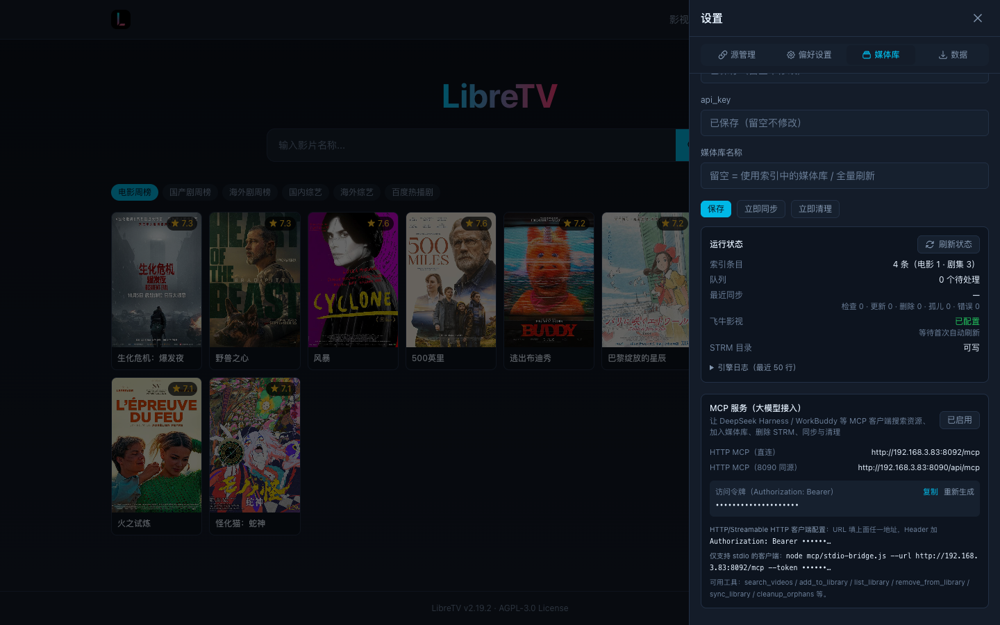

| 项 | 值 |
|---|---|
| HTTP MCP（直连） | `http://<NAS-IP>:8092/mcp` |
| HTTP MCP（8090 同源） | `http://<NAS-IP>:8090/api/mcp` |
| 鉴权 Header | `Authorization: Bearer <MCP_TOKEN>` |

### 9.2 客户端配置（HTTP / Streamable HTTP）

```json
{
  "mcpServers": {
    "libretv": {
      "type": "http",
      "url": "http://<NAS-IP>:8092/mcp",
      "headers": { "Authorization": "Bearer <MCP_TOKEN>" }
    }
  }
}
```

> 不同客户端字段名可能是 `transport` / `httpHeaders`，核心是 URL + Authorization Header。
> DeepSeek Harness / WorkBuddy：在 MCP Servers 设置中新增 HTTP Server，填 URL 与 Header。

### 9.3 仅支持 stdio 的客户端

```bash
node mcp/stdio-bridge.js --url http://<NAS-IP>:8092/mcp --token <MCP_TOKEN>
```

### 9.4 常用工具

| 工具 | 作用 |
|---|---|
| `search_videos` | 搜索资源 |
| `add_to_library` | 加入媒体库（与手动「加入媒体库」同一队列/引擎） |
| `list_library` | 列出条目（含资源目录、季信息） |
| `remove_from_library` | 默认递归删除整个资源目录；`season=N` 只删该季文件夹；支持 `dryRun` |
| `sync_library` | 追更 / 补齐缺失文件 / 失效清理 |
| `cleanup_orphans` | 清理孤儿 STRM + 空资源目录 |
| `refresh_media_library` | 触发影视扫描 |

示例：

```text
“帮我搜索《庆余年》，选一个源加入影视库”
→ search_videos → add_to_library

“把《庆余年》从影视库删掉”
→ remove_from_library {title:"庆余年"}   （删除整个资源目录）

“只删第一季，第二季保留”
→ remove_from_library {title:"庆余年", season:1}
```

> 中继（FN Connect）下 8090/8092 不可达，MCP 请在局域网/公网直连环境使用。
> 完整客户端配置见 `docs/MCP-SETUP.md`。

---

## 10. 目录结构与配置项

| 路径 | 内容 |
|---|---|
| `/vol2/@appcenter/libretv/server/` | 应用运行载荷（Next、engine、mcp、updater、start.js） |
| `/vol2/@appdata/libretv/` | 应用数据 `var`：配置、索引、队列、日志、更新备份 |
| `/vol2/1000/liberTV/strmdata/` | STRM 媒体库根目录（建议） |

`var/config.json` 主要字段：

| 字段 | 说明 |
|---|---|
| `password` | LibreTV 访问密码 |
| `strmRoot` | STRM 根目录绝对路径 |
| `syncIntervalHours` | 同步/追更间隔（1–168 小时） |
| `sources` | 采集源列表 |
| `fnv` | 飞牛影视 base_url、账号、密钥、媒体库名 |
| `mediaProxy` | 8091 兼容代理开关/端口 |
| `mcp` | MCP 开关、端口、Token |
| `update` | OTA 开关、仓库、间隔 |
| `cleanupEmptyDirs` | 是否回收空资源目录（默认 true） |
| `emptyDirGraceMinutes` | 空目录宽限分钟数（默认 5） |

---

## 11. 常见问题与故障排查

| 现象 | 原因与处理 |
|---|---|
| 安装报权限错误 | FPK 生命周期脚本以应用用户执行，不要手动改应用目录所有者；重装并在应用设置授权目录 |
| 加入媒体库后影视不显示 | 检查授权目录、STRM 根目录一致；到飞牛影视手动扫描一次 |
| 播放报“直连播放异常” | 局域网/公网改用 8091 兼容入口；中继场景检查客户端到源站 CDN、Clash 直连规则 |
| 中继下 8090/8091 打不开 | 正常：中继只转发 fnOS 主网关；请用飞牛影视原生 App |
| MCP 401 | Token/Header 错误；到设置页复制或重新生成 |
| MCP 8092 超时 | 中继不转发；确认端口放行；或改用 8090/api/mcp |
| OTA 没有更新按钮 | 当前已是最新版；按钮只在有新版时出现，位置在顶部导航右侧 |
| 更新后应用中心版本没变 | 正常：OTA 只更新运行载荷，不改应用中心安装记录 |
| 空目录被误删 | 目录内 0 个 `.strm` 且超过宽限期即回收；可设置 `cleanupEmptyDirs:false` 关闭 |
| 追更不生效 | 确认同步间隔、采集源详情已更新；看设置页引擎日志 |

---

## 12. 安全、备份与卸载

- **Token**：MCP Token 等同媒体库管理权限，不要发到公开群；泄露后立即在设置页重新生成；
- **删除风险**：MCP/后台删除资源目录是递归删除，先用 `list_library` 确认，必要时 `dryRun`；
- **备份**：定期备份 `/vol2/@appdata/libretv`（配置/索引）与 `strmdata`；
- **卸载**：应用中心卸载会保留 `var/`（配置/索引）；重装后无需重新配置，但建议确认授权目录。

---

## 13. 附录

- 项目仓库：<https://github.com/HarmonyRun/LibreTV-fnOS>
- Releases：<https://github.com/HarmonyRun/LibreTV-fnOS/releases>
- MCP 接入文档：`docs/MCP-SETUP.md`
- 远程访问说明：`docs/REMOTE-ACCESS.md`
- OTA 说明：`docs/UPDATE.md`
- Clash 直连规则：`docs/CLASH-RULES.md`

版本历史：

| 版本 | 主要内容 |
|---|---|
| 1.0.9 | 自动追更、缺失补齐、空资源目录回收 |
| 1.0.8 | MCP 按资源目录/按季删除 |
| 1.0.7 | OTA 自动更新 |
| 1.0.3 | MCP 服务 |
| 1.0.2 | 影视兼容代理 |
| 1.0.1 | 首个可用版本（STRM 引擎 + 飞牛影视扫描） |
